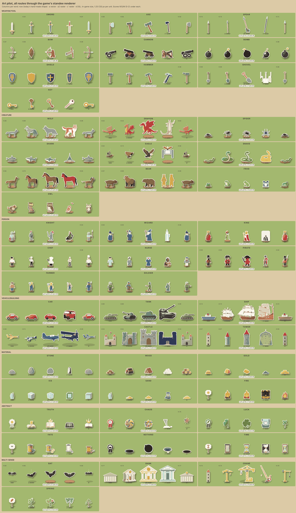

# Art pilot: 50 words

The 50-word pilot from `ART_TOOLS.md`, run on 2026-11-14. It tested four routes, cut the results
out, snapped them to `palette.ts` and drew them with the game's standee renderer at in-game
size, next to today's shape for each word.

**Result:** Z-Image-Turbo with a flat token-style prompt (route a2) is the route for the
3,000-word run. It costs about $0.003 per image hosted, keeps the paper look next to the
hand-made shapes, and produced an acceptable image for 40 of 50 words from 2 seeds. The output
should be **raster**: tracing the images to `Silhouette` polygons loses holes and small detail.
Recraft is out (scenes, crops, $0.08 an image). The style LoRA (route b) could not be trained,
because fal's trainer needs a hosted zip and the fal upload host was not usable from this session.

Sheets: [combined](art-pilot/combined.png) · [a](art-pilot/route-a.png) ·
[a2](art-pilot/route-a2.png) · [c'](art-pilot/route-c.png) · [d](art-pilot/route-d.png).
Each sheet shows the words at 1.25 CSS px per unit, so a person is 50 px tall, the middle of the
camera's zoom range. "×0.7" on a slot means it was shrunk to fit the cell. In the route sheets,
each word has the raw image, **now** (today's shape), **vector** (traced into a `Silhouette` and
drawn by `renderStandee`) and **raster** (the palette-snapped cut-out with a paper border, shadow
and stand).

## Words

| Group | Words |
|---|---|
| Weapons and tools (10) | sword axe spear bow cannon bomb shield hammer shovel key |
| Creatures (10) | wolf dragon spider shark eagle snake horse bear frog owl |
| People (8) | knight wizard king chef nurse pirate farmer soldier |
| Vehicles and buildings (6) | car tank ship plane castle tower |
| Materials (6) | stone wood gold ice sand fire |
| Abstract (6) | truth chaos luck fate nothing time |
| Multi-sense (4) | bat (animal) bank (building) crane (machine) spring (season) |

All 50 are in `data/demo.json`. 46 already have a shape of their own in `WORDS`. Sand, ice, fire
and spring use their archetype's shape, and crane maps to the tower shape.

**The `synset` column cannot be used to write prompts.** For 7 of the 50 words, its gloss names a
different sense from the one the game uses (class and archetype in `demo.json`):

| Word | Game sense | `synset` gloss |
|---|---|---|
| key | tool (door key) | "a lever (as in a keyboard)…" |
| wizard | person: worker, magic damage | "someone who is dazzlingly skilled in any field" |
| pirate | criminal, sea raider | "someone who uses another person's words or ideas…" |
| castle | fortified building | "a large and stately mansion" |
| bank | building (storage, trade) | "sloping land beside a body of water" |
| time | duration (a time field) | "an instance or single occasion for some event" |
| nothing | void event | "a quantity of no importance" |

The prompts in this pilot were written from the class, archetype and stats, not the gloss. Step 1
of the pipeline should do the same, and the `synset` picks in `build_lexicon.py` should be checked
against the archetype (see "What to change").

## Prompt template

Each word got one subject line and a few colour hints, written by hand from its game sense (for
example "a brass door key with a round bow and a toothed bit"; "spring" was "a young green sapling
with fresh leaves and pink blossoms"). The subject line was then put into a fixed template.

Route a, and route c' with the same text:

> Flat cut-paper craft standee of {subject}. Front view at a slight three-quarter angle, the whole
> subject visible and centred with an empty margin. A few flat matte paper colours ({colours}),
> bold simple shapes, minimal interior detail. Plain white background, no shadow, no text, no
> frame, no border.

Route a2:

> Simple flat paper cut-out token of {subject}. Side view, one chunky readable silhouette made of
> a handful of flat solid-colour paper shapes ({colours}) with clean straight-cut edges, small dark
> dot eyes on living things. No gradients, no texture, no shading, no outline. Centred on a plain
> white background, no shadow, no text, no frame.

There was no Claude API key in this session, so Claude (Opus, working in the session) did the
three "Haiku" steps itself: it wrote the subject lines, wrote the route d silhouettes, and judged
the images. A real run would use Haiku 5.5 through the Batches API. Haiku's DSL output is likely
to be worse than route d's, and its judging less consistent.

## Routes

| Route | What ran | Endpoint | Status |
|---|---|---|---|
| a | Z-Image-Turbo, prompt only, 768², seed 7, 8 steps | `fal-ai/z-image/turbo` | ran |
| a2 | Z-Image-Turbo, token-style prompt, 2 seeds, best picked by eye | `fal-ai/z-image/turbo` | ran (added in place of b) |
| b | Z-Image-Turbo + style LoRA trained on 52 flat renders of hand-made shapes | `fal-ai/z-image-trainer` | **blocked**: the trainer refused a `data:` URI zip ("URL too long"), and the fal storage upload (`rest.alpha.fal.ai`) returned 401 because no credential is injected for that host |
| c' | Recraft V3, **built-in** style `vector_illustration/cutout`, SVG | `fal-ai/recraft/v3/text-to-image` | ran. The planned custom style (`recraft/v3/create-style`) has the same upload block: it fetches the zip from a URL and refused a `data:` URI. Recraft V4 vector has no custom-style input on fal. |
| d | `Silhouette` DSL written directly with the `build.ts` builders | none | ran |

Background removal used `fal-ai/birefnet/v2` (General Use Light, 1024) for all raster routes.
It accepted both fal result URLs and `data:` image URIs.

Steps after the cut-out ran locally in this session, in numpy (vtracer was not available):

- crop to the alpha box and drop specks smaller than 2% of the largest part;
- k-means into 6 colours, each snapped to the nearest `palette.ts` colour;
- for vector, trace each colour region on a 96 px grid and simplify with Ramer-Douglas-Peucker.
  The outline becomes `part` pieces and the colour regions become `dot` pieces, scaled to
  today's shape's size.

The training renders for route b are ready to reuse. Each one is a hand-made `WORDS` shape drawn
flat by `drawSilhouette` at 768² on white, with no shadow or stand.

## Costs and timing

| Route | Calls | fal cost | Wall time for 50 (8 in parallel) | Per image |
|---|---|---|---|---|
| a | 50 Z-Image + 50 BiRefNet | $0.15 + ~$0.05 | 19 s + 14 s | ~0.6 s inference, $0.003 |
| a2 | 50×2 Z-Image + 52 BiRefNet | $0.30 + ~$0.05 | 26 s + 9 s | $0.003 |
| b | 1 trainer job (failed validation, no steps ran) | $0 expected ($2.26 if billed) | n/a | n/a |
| c' | 1 create-style (rejected) + 50 Recraft + 50 BiRefNet | $4.00 + ~$0.05 | 71 s + 7 s | ~10 s, $0.08 |
| d | none | $0 (Haiku batch would be ~$0.0005/word) | about 15 min of writing | n/a |
| Smoke test | 1 Z-Image | $0.003 | | |
| **Total** | | **≈ $4.61** (worst case $6.87) | | |

Local processing (crop, snap, trace) took about 0.2 s per image, and the sheets render in about
20 s. BiRefNet is billed per compute second, and fal's page shows no rate, so ~$0.001 per image
is an upper estimate. Check the fal billing page for the trainer job (request
`01a1daf1-…`); it failed input validation after 17 s and should not have been charged.

## Scores

Each route was judged on its best output for the word (raster for a, a2 and c'), by eye at game
size. Every score is 0, 1 or 2:

- **R**, recognisable without the label;
- **S**, on style next to the hand-made shapes;
- **M**, meaning: the game's sense, shown clearly.

A word is **accepted** when R = 2, S ≥ 1 and M = 2. The per-word scores are printed under each
cell in the sheets.

| Route | R (of 100) | S (of 100) | M (of 100) | Mean /6 | Accepted | Cost per accepted word |
|---|---|---|---|---|---|---|
| a | 93 | 57 | 93 | 4.86 | **42** | $0.005 |
| a2 | 92 | 89 | 90 | 5.42 | **40** | $0.009 (2 seeds) |
| c' | 61 | 20 | 87 | 3.36 | 14 | $0.29 |
| d | 82 | 98 | 93 | 5.46 | 33 | ~$0.0005 with Haiku |

How to read these:

- Route d's S is high by construction, because it is drawn by the same code.
- Route d is also flattered. 46 of the 50 words already have hand-made shapes, the model writing
  it had read `shapes.ts`, and most of its shapes call the same builders. So d mostly reproduces
  today's shapes, and is weakest where no builder fits (luck, axe blade, farmer's fork,
  eagle).
- Route a scores lower on style than a2 because its images have soft shading, paper grain and a
  3D look (castle, bank, eagle). After the palette snap they still read well.
- Route a2's misses are prompt bugs (below), so its acceptance should rise once the prompt is
  fixed.

## Failure modes

- **"Small dark dot eyes on living things" leaks.** a2 put faces on a stone, hammer, gold bars,
  logs and an hourglass, and added a small bear beside the bow and the spear. Drop the clause; the
  renderer can add eyes.
- **Abstract words are weak on every route.** Truth (a book), chaos (a pinwheel or burst), fate
  (thread and scissors) and nothing (a hole) are readable as pictures, but not as the word. Luck
  came out as a 3-leaf shamrock on both Z-Image routes even though the prompt said four-leaf. For
  abstract words, keep today's placards and rosettes or put the symbol on one, rather than
  drawing a free-standing object.
- **Tracing to vector loses information.** Holes are filled (the bow becomes a leaf shape, the
  hourglass a frame), the crane lattice and fine detail disappear, and thin things (spear) lose
  width. A tracer that keeps holes (vtracer) would help, but the raster cut-out already looks
  better at game size.
- **Recraft ignores "plain white background".** It makes framed posters and scenes: an eagle on a
  frame, fire in a forest, a king on a card. It also crops subjects (cannon, car, ship) and adds
  text ("BANK"). BiRefNet then keeps the frame or the scene. Recraft also lost the sense twice:
  sand became an hourglass, chaos a tornado.
- **Scale.** Generators fill the frame, so the output must be scaled by the word's size class
  (done here by matching today's shape). Wide buildings and the dragon are shrunk in the sheet
  cells; in game they draw at full size.
- **Wrong sense from the data.** See the `synset` table above. With the gloss as the prompt,
  key would become a keyboard lever, pirate a plagiarist and bank a riverbank.
- **Today's shapes have gaps too.** Crane is drawn as a tower, sand as a crystal, and ice as a
  shard. All of these routes improve on them.

## Recommendation for the 3,000-word run

1. **Route: Z-Image-Turbo with the a2 template minus the eyes clause, 4 seeds per word, raster
   output.** Hosted on fal, 12,000 images cost about $36 plus about $12 of BiRefNet.
   Self-hosting, as `ART_TOOLS.md` plans, is only worth it at the 300k scale.
2. **Train the style LoRA anyway**, once an upload path exists: a fal key for
   `rest.alpha.fal.ai` uploads, or a public URL for the zip. It costs $2.26 for 1,000 steps. The
   52 training renders are ready, and the best a2 outputs can be added. The LoRA is what keeps
   later batches matching. The prompt alone already gets a2 close.
3. **Output raster, not `Silhouette`:** about 128 px tall, palette-snapped, with the border,
   shadow, stand, flames and badges drawn by code as today. Keep `Silhouette` and archetype
   shapes as the fallback, and for abstract, event, aura and season words.
4. **Prompts from game sense:** class, archetype, key stats and colour/material, not the WordNet
   gloss. For abstract words, ask for a symbol on a placard.
5. **Automatic QC before review:** a single main component, nothing touching the edge, at most 6
   colours after the snap, then a vision check (Haiku) for "is this <word> as <sense>?" and "has a
   face or an extra animal?".

## What to change

- Check `synset` against `archetype` in `tools/build_lexicon.py`. At least 7 of these 50 disagree,
  so the 3,000-word list needs an audit before prompts are written.
- `look.ts` / `standee.ts`: add a raster path (draw an image with a paper border, as the sheet's
  raster slot does) next to `drawSilhouette`.
- Fix `WORDS.crane` (a tower) and give sand, ice and fire their own shapes even if no art run
  happens.
- Get a fal upload credential (or another way to host a training zip) before route b and the
  Recraft custom style can be tested.
