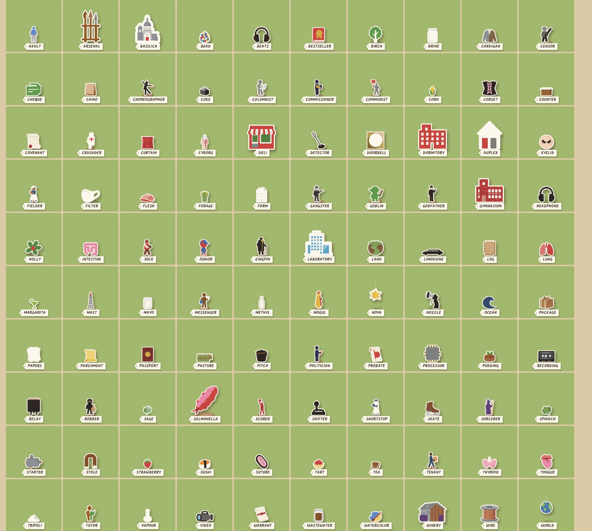

# Generated word art

The 3,000-word run that follows the [pilot](ART_PILOT.md). Each word gets a small palette-snapped
cut-out image, made ahead of time; the game draws it through the same standee renderer as the
hand-made shapes (paper border, drop shadow, stand, flames, frost, dye, crowds).

Run on 2026-11-14. **Result:** 2,964 of 3,000 words have an image (2,795 from the first round,
169 from one retry with a rewritten subject); 36 keep their drawn shape and are listed in
`tools/art/rejects.tsv` for a human look. Along the way 4,362 more frequent words were skipped because they
keep a placard or rosette (1,537 adjectives, 791 events, 574 verbs, 405 auras, 251 knowledge,
247 institutions, 215 adverbs, 116 weather and phenomena, 99 terrain places and depressions,
63 afflictions, 61 measures, 3 spells) and 27 plurals use their singular's image.
The images take **1.84 MB** in all (about 620 bytes each, lossless WebP), and each one loads
the first time its word is drawn.

| | |
|---|---|
| Style LoRA | **kept**, scale 1.0: flatter colour, no paper grain, and clean white backgrounds where the prompt alone gave grey ones (bomb, shark, chef, crane); recognisability the same. [Comparison](art-pipeline/lora.jpg) |
| Candidates | 12,820 (3,000 × 4, then 205 retries × 4) at 640², $0.0035 each |
| Judged | 300 contact sheets of 10 words by five Claude sessions, 21 retry sheets by a sixth |
| Cut-out | BiRefNet for the first 1,021 picks; the fal balance ran out there, so the other 1,943 use the local cut-out (`ART_CUT=local`), which matched BiRefNet on these plain backgrounds (`tools/art/picks.tsv` says which) |
| fal cost | ≈ $48.5 (estimated from list prices: trainer $2.26, LoRA generation $45.0, validation $0.5, BiRefNet ≈ $1.0) |
| Frame rate | headless Chromium, software GL, 12 generated words on screen: 3.9 fps before, 4.5 after (two runs each, noise ±0.4) |



Rejects (second-round candidates): [rejects.jpg](art-pipeline/rejects.jpg). They are mostly body
parts and soft or abstract things that have no clear silhouette (skin, hip, nerve, tendon,
scar, cyst, residue, fabric, silk) and ship parts (keel, rudder, jetty).

Known weaknesses: people come out as faceless pictograms in costume (the style of the hand-made
shapes the LoRA learned from), which reads well at game size but makes many jobs look alike;
image size follows the drawn shape it replaces, so a few words (SALMONELLA) are larger than
life.

## In the game

- `client/public/art/words/<word>.<hash>.webp`: one lossless WebP per word, longest side 128 px,
  at most 6 palette colours. `manifest.json` lists them: `words[word] = [file, w, h, top]`
  (`top`: the top edge in five bands, for flames) and `alias` (a plural that uses its singular's
  image, from `tools/art/aliases.tsv`).
- `client/src/art/raster.ts` fetches the manifest when the scene starts and a word's image the
  first time the word is drawn. Until it arrives the word keeps its drawn shape.
- Precedence: generated image, then the hand-made `WORDS` shape, then `ARCHETYPES`, then
  `CLASSES`. The drawn shape still decides the image's size (its longest side), whether it
  stands on a base (`living`) or hangs on a thread (`flies`).
- `paper.ts` `drawRaster` gives the image a white cut border and the drop shadow;
  `standee.ts` uses it for the body, crowd copies and swarm fronts. An adjective's colour
  (RED KEY) dyes it (`Look.dyed`), FROZEN frosts it, INVISIBLE and HIDDEN fade it.
- `gallery.html` shows the first 200 generated words; `?gen=all`, `?gen=wolf,key`,
  `?compare=1` (the drawn shape beside each) and `?phrases=red key,burning bank`.

## Making it again

All scripts are in `tools/art/`. Downloads and candidates go in a work folder outside the repo
(`ART_WORK`); run Python that reads them with `-I`. fal.ai credentials come from `FAL_KEY` or a
proxy that injects them; each paid call is logged with its estimated cost in `$ART_WORK/costs.md`.

```
python3 tools/art/select_words.py <wordnet dict dir> 3000   # words.tsv, aliases.tsv
# subjects.tsv: one subject line and 2-4 colours per word, written from the game data (below)
export ART_WORK=/some/scratch/folder
python3 -I tools/art/pipeline.py prompts      # prompts.tsv (round 1 and retries)
python3 -I tools/art/pipeline.py generate     # 4 seeds per word -> raw/<word>/<seed>.png
python3 -I tools/art/pipeline.py qc           # local cut-out and checks -> qc.json
python3 -I tools/art/pipeline.py sheets 10    # contact sheets for judging
# picks.tsv (word, cand) from the judging; rejects get subjects_retry.tsv, then
ART_ROUND=2 python3 -I tools/art/pipeline.py generate   # seeds 55-88 for the retries
python3 -I tools/art/pipeline.py finish       # BiRefNet, crop, snap, WebP, manifest
```

- **Words** (`select_words.py`): the most frequent words (zipf) in `data/demo.json` with no
  `WORDS` shape. Skipped: adjectives, verbs, adverbs, and the noun classes that keep a placard or
  rosette (event, aura, knowledge, institution, world_state, affliction, measure, spell; terrain
  places and depressions); a plural whose singular is in the dictionary uses its singular's image.
- **Subjects** (`subjects.tsv`): written from the word's class, archetype and properties in
  `demo.json` (KEY, a tool that counters `lockable`, is a brass door key; BANK, a building that
  stores letters, a bank with columns and a vault door; FRANK, food, a frankfurter). The WordNet
  gloss is only a hint: `words.tsv` carries it with `gloss_class_matches` and other senses. The
  rules are those in the "Subject rules" below. Written by Claude sessions (no API key in the
  session); a Haiku batch would do the same.
- **Prompt**: the pilot's a2 template without "dot eyes", with the LoRA trigger `lwpaper`;
  people and creatures add "full body"; a subject whose first colour is white, cream, silver or
  pale gets a mid-grey background so it can be cut out.
- **Generation**: `fal-ai/z-image/turbo/lora`, 640×640, 8 steps, seeds 11, 22, 33, 44 (retries
  55, 66, 77, 88), the style LoRA at scale 1.0.
- **Style LoRA**: `fal-ai/z-image-trainer`, 1,000 steps, `training_type: style`, on 60 flat
  renders (1024², white) of hand-made `WORDS` shapes, captioned
  "lwpaper flat paper cut-out token of <subject>, side view, on a plain white background".
  The weights URL is in `pipeline.py` (`LORA`).
- **QC** (`qc`): a local cut-out (flood fill from the border colour at 160 px) on every
  candidate. Hard rejects: empty, touching the edge (cropped), filling the frame (a scene or a
  card), tiny. Soft: several pieces or scattered bits (white parts on white split the local
  cut-out, so these only lower the score).
- **Judging**: contact sheets of 10 words, the 4 candidates with a game-size copy and the QC
  verdict. A judge picks A-D or rejects, and writes a better subject for a reject. Rejects are
  generated once more with the new subject and judged again; words still failing keep their
  drawn shape and are listed for a human look.
- **Finish**: BiRefNet (`fal-ai/birefnet/v2`, General Use Light) on the pick only, crop to the
  alpha, drop specks under 2% of the main part, scale to 128 px, k-means to 6 colours snapped to
  the palette (`palette.ts` colours and the renderer's light, dark and deep shades of each), and
  a lossless WebP named by its hash.

### Subject rules

1. Show the game meaning; where the gloss disagrees with class, archetype or properties, the
   game data wins.
2. One concrete object, creature or figure, whole and alone, recognisable at about 50 px. No
   scene, text, logo or frame.
3. People: one standing person whose costume and one held prop show the role. Never a real
   person's likeness.
4. Materials: a lump, pile, ingot, sack, jar, barrel or crystal; liquids and gases in a bottle
   or flask; food and drink as the dish or drink.
5. Body parts: the part alone, cartoon, not gory. Rude words: their game meaning, inoffensive.
6. Words that sound abstract but are things in the game get the object that holds them (a
   document, a laptop with a web page, a film reel, a money sack).
